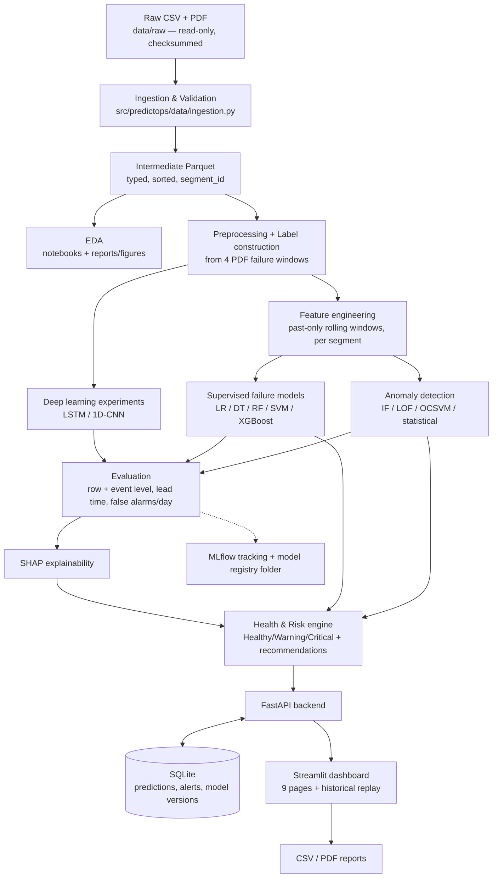

# 00 — Project Setup & Architecture (Stage 3)

This document explains **what was set up, why, and how to verify it**. Read it alongside
`01_dataset_inspection.md` (what the data actually contains) and `data_dictionary.md`.

---

## 1. Environment

| Item | Choice | Why |
|---|---|---|
| Python | **3.12.16** (Homebrew `python@3.12`) | Your Mac's default 3.14 is too new — several ML libraries (SHAP's numba, some wheels) lag behind. 3.12 is the safest well-supported version. |
| Isolation | `.venv/` virtual environment in the project | Keeps project libraries separate from system Python; anyone can recreate it. |
| OpenMP | `brew install libomp` | XGBoost's macOS build needs the OpenMP runtime for multi-threading. Without it `import xgboost` fails (we hit this error during setup). |
| Package | `pip install -e .` (editable, via `pyproject.toml`) | Lets every script / notebook / API do `from predictops... import ...` without path hacks. |

Verified versions (from `requirements.lock`): numpy 2.5.4, pandas 3.1.1, scikit-learn 1.9.1,
xgboost 3.4.1, shap 0.54.1, torch 2.15.0 (Apple MPS GPU available), fastapi 0.162.0,
streamlit 1.67.0, mlflow 3.18.0, imbalanced-learn 0.14.2.

### Recreate from scratch
```bash
brew install python@3.12 libomp
cd "PredictOps"
/opt/homebrew/bin/python3.12 -m venv .venv
source .venv/bin/activate
pip install -r requirements.lock        # exact versions (reproducible)
pip install -e .
cp .env.example .env
python scripts/build_intermediate.py    # raw CSV -> Parquet
python scripts/inspect_dataset.py       # regenerate docs/01 + data dictionary
pytest -q                               # expect: all tests pass
```

`requirements.txt` lists *direct* dependencies with minimum versions (human-readable);
`requirements.lock` is `pip freeze` output with every exact version (reproducible).

---

## 2. Technology stack — final decisions

| Layer | Technology | Why it is needed (and nothing more) |
|---|---|---|
| Data | pandas + **pyarrow/Parquet** | Parquet stores typed columns compressed: 218 MB CSV → 29 MB file, 91 MB in RAM, loads in < 1 s instead of re-parsing CSV. |
| Classical ML | scikit-learn, XGBoost | Required model families (LR, DT, RF, SVM, XGBoost) + pipelines that prevent leakage. |
| Imbalance | imbalanced-learn | SMOTE/ADASYN/samplers; its `Pipeline` resamples **only inside training folds**. |
| Deep learning | **PyTorch** (not TensorFlow) | Better Python 3.12 + Apple-Silicon (MPS) support; explicit training loop is easier to explain in a viva. |
| Explainability | SHAP | `TreeExplainer` is exact and fast for tree models. |
| Tracking | MLflow (local `mlruns/` folder, no server) | Records params/metrics/artifacts for each run; satisfies model versioning without extra infrastructure. |
| Drift | SciPy (KS test) + PSI implemented by us | Avoids adding a heavy drift library for two statistics. |
| Backend | FastAPI + Pydantic | Typed request validation + automatic `/docs` API documentation. |
| Database | SQLite via SQLAlchemy | Zero-setup file DB; SQLAlchemy makes a later PostgreSQL switch a one-line URL change. |
| Frontend | Streamlit + Plotly + custom CSS theme | Python-only, fast to build; custom CSS avoids the "default widgets" look. React was **not** chosen — it would add a second language and build system without a requirement that needs it. |
| Reports | reportlab | PDF generation in pure Python. |
| Tests | pytest + httpx | Unit, integration and API tests. |

---

## 3. System architecture



**How data moves:** the raw file is read exactly once into Parquet. Every later stage reads the
Parquet (or its own saved output), never the CSV. Trained models and preprocessing objects are
saved to `models/`; the API loads them once at startup and never retrains during requests.

---

## 4. Folder structure (what each part is for)

```
PredictOps/
├── configs/config.yaml        # single source for paths, sensor lists, gap threshold, failure windows
├── data/
│   ├── raw/                   # original CSV + PDF, read-only (chmod a-w) + SHA256SUMS
│   ├── intermediate/          # metropt3.parquet (typed, segmented)
│   ├── processed/             # engineered features (Phase 4)
│   ├── train/ validation/ test/  # chronological splits (Phase 3)
│   └── sample/                # small real excerpts for demo / upload testing
├── docs/                      # one document per phase — review material
├── notebooks/                 # exploration & explanation (EDA, results) — logic lives in src/
├── scripts/                   # runnable pipeline steps (build data, train, evaluate)
├── src/predictops/            # reusable library: data, features, models, anomaly, explain, inference…
├── backend/                   # FastAPI app (Phase 12)
├── frontend/                  # Streamlit app (Phase 14)
├── models/                    # trained/, preprocessing/, metadata/
├── database/                  # SQLite file (git-ignored)
├── reports/figures/           # generated charts
├── tests/                     # pytest suite
├── requirements.txt / .lock, pyproject.toml, .env.example, .gitignore
```

Design rule: **notebooks explain, `src/` implements.** Anything the app needs at inference time
lives in `src/` so training and serving share exactly the same code.

---

## 5. Key decisions made in this stage

1. **Raw data copied and write-protected** (`chmod a-w`), with SHA-256 checksums. A test
   (`tests/test_intermediate_data.py::test_raw_file_untouched`) proves it is unchanged.
2. **Sampling = ~10 s**, not the 1 Hz stated in the PDF (the CSV is a 1-in-10 subsample of the
   original log). All windows will be defined in time units based on this.
3. **Segments**: gaps > 10 min start a new `segment_id` (231 segments). Rolling features and
   sequences never cross a gap, and gaps are never interpolated.
4. **Failure windows** copied verbatim from the PDF into `configs/config.yaml`; inconsistencies in
   the official table are documented rather than "corrected".
5. **Primary formulation:** anomaly detection (evaluated against the 4 windows); supervised
   failure-window detection / early warning as a secondary, honestly-scoped task. No RUL claim.
6. Raw CSV is git-ignored (218 MB > GitHub's 100 MB file limit); the README explains how to obtain it.

---

## 6. How to verify this stage

```bash
source .venv/bin/activate
pytest -q                                   # 14 passed
python scripts/build_intermediate.py        # rows=1,516,948 segments=231
python -c "import xgboost, shap, torch; print('ok', torch.backends.mps.is_available())"
```

## 7. Known limitations / open points
- Only 4 failure events → supervised results will have high variance (see docs/01 §9–10).
- The PDF's failure table has numbering/maintenance-date inconsistencies (docs/01 §9).
- No Git commit has been made yet — see README "Git" section.
