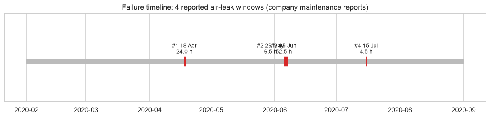
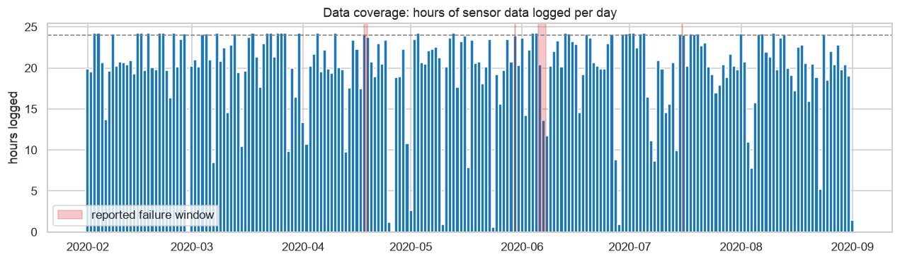
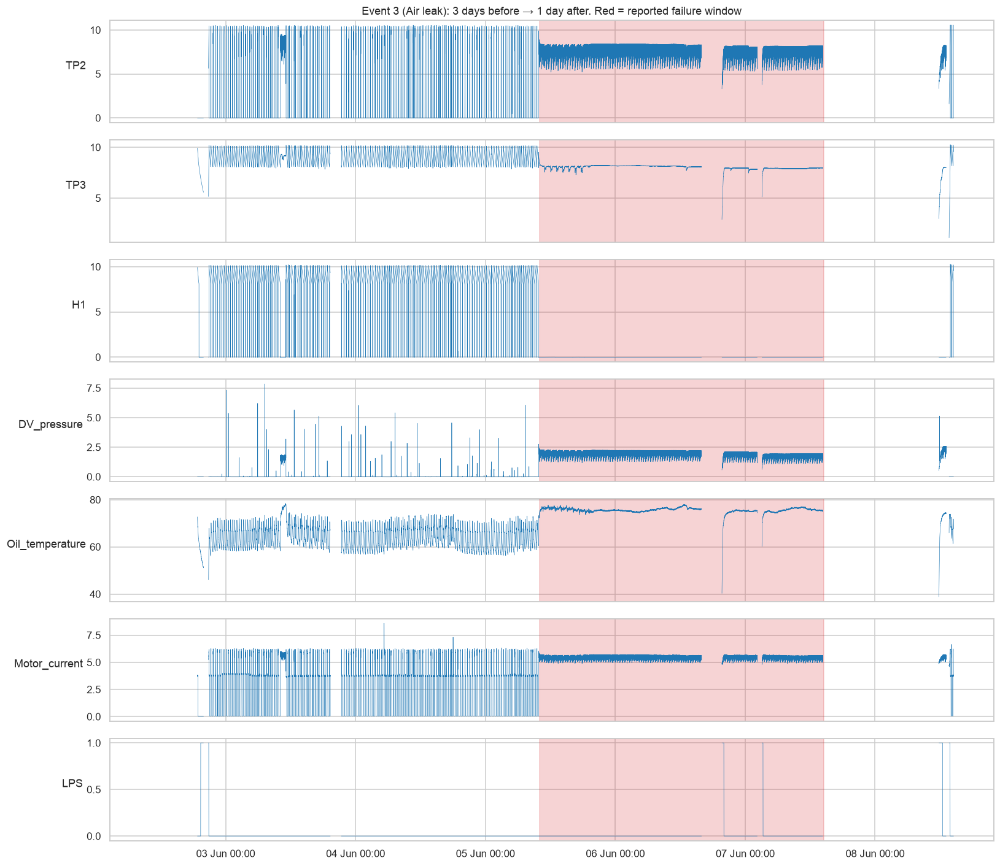
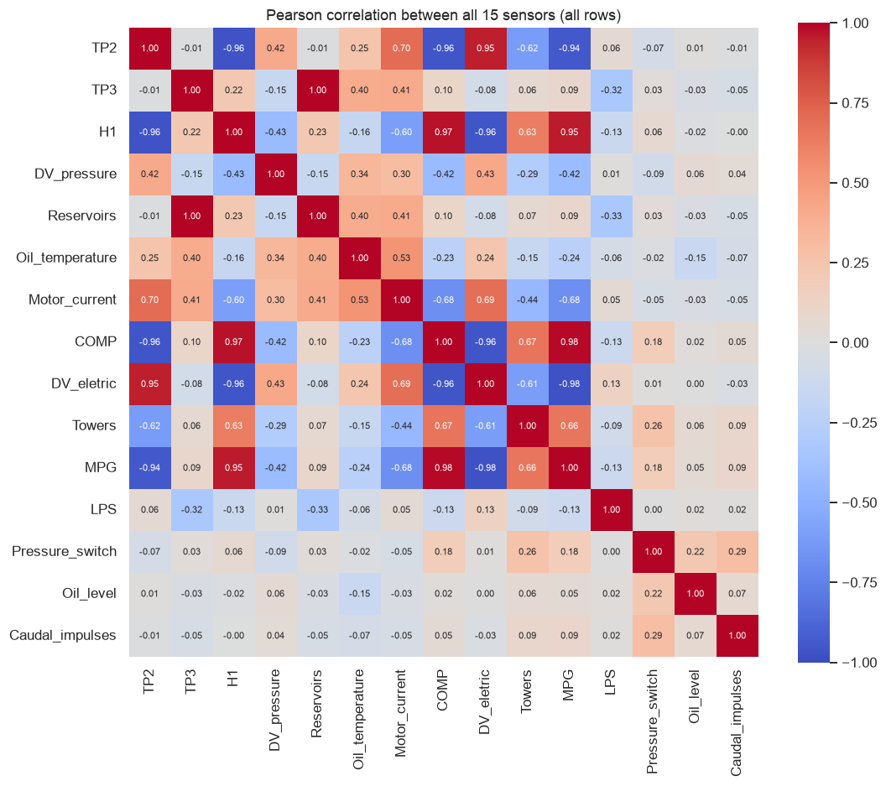
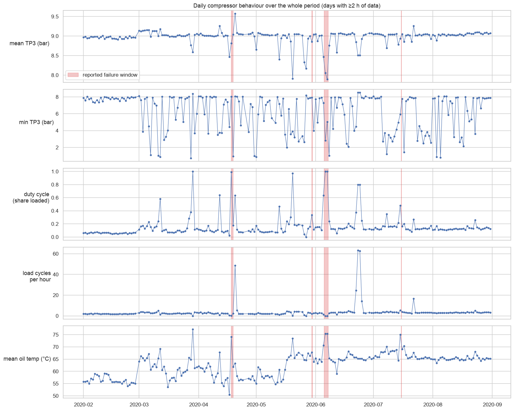
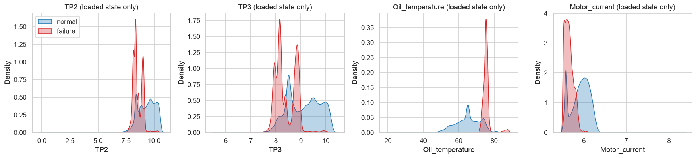

# 02 — Exploratory Data Analysis (Stage 4a)

**Reproduce:** `.venv/bin/python scripts/run_eda.py` (~10 s). Charts → `reports/figures/eda/`,
numeric tables → `reports/eda_stats/`. Interactive version: `notebooks/02_exploratory_analysis.ipynb`.
All charts use the real data only. Where a chart uses a sample, the sample is seeded and stated.

> **Main findings (read this first)**
> 1. The reported failure windows have a **very strong and distinctive sensor signature**: the
>    compressor stays loaded continuously, H1 drops to ~0, DV_pressure stays around 2 bar and the
>    oil runs ~13 °C hotter. Spotting a failure that is *already happening* is therefore easy.
> 2. For events 1–3 there is **no visible gradual change** in the 3 days before onset: the
>    signature starts abruptly. Event 4 is different: oil temperature climbs for ~12 h and
>    pressure sags *before and during* the window. **Warning ahead of time will be hard and must be
>    judged per event.**
> 3. The same sustained signature also appears in **3 periods the company never reported**
>    (12 Apr, 13 May, 19–20 May; 10–21 h each). The "normal" class is probably **contaminated
>    by unreported failures**, so labels are noisy.
> 4. **7 "frozen" periods** (3.3% of rows) where all analog sensors repeat exactly the same
>    value for 1–51 h: the logger kept recording a stale value. These must be flagged and left
>    out of training.
> 5. Sensor values are governed by **operating regimes** (off / offloaded / loaded). Comparing raw
>    values without accounting for the regime is misleading.

---

## 1. Failure timeline — `01_failure_timeline.png`

- **What it shows:** the 7-month observation period with the 4 reported air-leak windows (4.5 h to 52.5 h).
- **What it tells us:** events are rare and spread out (April, end of May, June, July).
- **Impact:** a chronological train/validation/test split can give at most a few events to each
  part. Plan: events 1–3 for development (leave-one-event-out validation), **event 4 (July) as
  the final, untouched test event**. Event 4 also differs in pattern (see §5), which makes it a
  harder and more honest test.

## 2. Data coverage — `02_data_coverage.png`

- **What it shows:** hours of data logged per day (24 h = full day).
- **What it tells us:** most days have 17–24 h. Some days are nearly empty (end of April,
  late June). There are 230 gaps over 10 min, all logger-off periods.
- **Impact:** rolling windows are defined **within segments**; gaps are never interpolated. Metrics
  like "false alarms per day" must use *hours of data actually logged*, not calendar days.

## 3. Class distribution — `03_class_distribution.png`
- **Row level:** 1,486,994 normal vs **29,954 failure-window rows (1.97%)**, about 1:50.
- **Per month:** failure rows appear only in April, May/June and July.
- **Impact:** accuracy is useless (predicting "normal" always gives 98%). We will use PR-AUC,
  recall, F1, MCC and **event-level** detection. Imbalance handling is needed, but the bigger issue
  is that there are only **4 events**, not that there are few positive rows.

## 4. Distributions and operating regimes
### 4.1 Histograms — `04_histograms.png` (uniform sample of 200k rows)
- TP2, H1, DV_pressure and Motor_current are **multi-modal** (several peaks): each peak is an
  operating state, not noise. TP3/Reservoirs are roughly bell-shaped around 9 bar (the 8.2–10 bar
  control band). Oil temperature ranges 50–75 °C.
- **Impact:** the IQR outlier rule flags 16–18% of TP2/H1 rows simply because they're in a
  different operating mode (docs/01 §7). **Outliers are not removed**; anomaly detection must be
  regime-aware.

### 4.2 Motor-current regimes — `05_motor_current_regimes.png` (log scale)
- Clear peaks near **0 A (off)**, **~3.8 A (offloaded)** and **~5.5–6.2 A (loaded)**. Readings
  near 9 A (start) are extremely rare: start-up transients are shorter than the 10 s sampling.
  The PDF quotes ~7 A for loaded, but this machine actually runs at ~6 A.
- **Impact:** we derive an `operating_state` feature from motor current (thresholds 1 / 5.5 / 8.5 A).

| State share | Normal rows | Failure-window rows |
|---|---|---|
| off | 55.7% | 0.3% |
| offloaded | 32.1% | 31.1% |
| loaded | 12.1% | **68.6%** |

During failures the compressor is **almost never off**. It is trying to make up for the leaking air.

### 4.3 Digital sensors — `06_digital_shares.png`
| Signal | Normal | Failure window |
|---|---|---|
| COMP | 85.4% | **0.4%** |
| MPG | 84.9% | **0.4%** |
| DV_eletric | 14.4% | **99.5%** |
| Towers | 92.8% | 50.2% |
| LPS | 0.3% | 2.4% |

- **Interpretation:** during failures the outlet valve (DV_eletric) is essentially always open and
  the intake valve signal (COMP) is off, so the compressor is permanently "working".
- **Impact:** digital signals are very informative but they describe the *current* state.
  They are excellent for detection, not proof of predictive power.

## 5. Behaviour around each failure — `12_event{1..4}_zoom.png`

Each figure shows 3 days before to 1 day after a window (red). Lines break at recording gaps.

| Event | What happens | Gradual change before onset? |
|---|---|---|
| 1 (18 Apr) | Normal cycling → abrupt switch at 00:00 to continuous load: H1 → 0, DV_pressure ≈ 2 bar, oil ≈ 75 °C. Signature lasts until ~02:00 on 19 Apr, past the reported end. Preceded by a **frozen** period (17 Apr 09:20 → 18 Apr 00:18). | No (and hidden by frozen data) |
| 2 (30 May) | Same abrupt signature starting ~23:39, 9 min after the reported start. Preceded by a frozen period (26–28 May). | No |
| 3 (5–7 Jun) | Same signature for ~2 days, interrupted by two gaps; ends at maintenance. | No |
| 4 (15 Jul) | **Different:** no sustained H1 = 0 pattern. Oil temperature rises steadily from ~70 to 88 °C over ~12 h and TP3/TP2 sag from ~10 to 6 bar inside the window; LPS fires. | **Yes, hours before** |

**Physical reading:** with an air leak, pressure can't be held, so the compressor runs loaded
almost constantly. That raises current and oil temperature, and the normal on/off cycling (and
filter discharges seen in H1) disappears.

**Impact on the project:**
- *Failure-window detection* will look very good, because the signature is obvious. We must **not**
  present this as predicting failure in advance.
- *Early warning* (signal before the window starts) has support from event 4 only. Results will be
  reported per event, with lead time, and with the limitation stated clearly.

## 6. Unreported failure-like episodes — `reports/eda_stats/failure_signature_episodes.csv`
Using the descriptive signature (H1 < 0.5 bar, DV_pressure > 1 bar, motor current > 4.5 A held for over 80%
of a 30-minute window), we found:

| Start | End | Hours | Inside a reported window? |
|---|---|---|---|
| 2020-04-12 12:15 | 2020-04-12 23:40 | 11.5 | **No** |
| 2020-04-18 00:47 | 2020-04-19 01:59 | 25.4 | 92% (event 1) |
| 2020-05-13 14:10 | 2020-05-14 00:56 | 10.9 | **No** |
| 2020-05-19 22:46 | 2020-05-20 19:48 | 21.2 | **No** |
| 2020-05-29 23:39 | 2020-05-30 06:00 | 6.4 | 100% (event 2) |
| 2020-06-05 → 2020-06-07 | (3 parts) | 46.9 | 100% (event 3) |

- The signature covers **94% of reported failure rows** but also 1.36% of "normal" rows, mostly in
  these three long unreported episodes.
- **We cannot know** whether these were unreported leaks or an unusual but harmless operating mode.
  We will **not** relabel them as failures (that would mean inventing labels).
- **Impact:** in Phase 3 they will be marked as an *"uncertain"* group. Models will be evaluated both
  with them counted as normal (strict) and with them excluded from evaluation (sensitivity
  analysis). The dashboard will show them as *anomalous episodes*, not as confirmed failures.

## 7. Frozen-sensor periods — `reports/eda_stats/frozen_runs.csv`
7 runs ≥ 1 h where all 7 analog sensors are **exactly** identical (real analog sensors always
jitter slightly), 50,418 rows (3.3%). The longest are 22–25 Jun (51 h), 26–28 May (35 h),
20–21 Apr (17 h), 12 Jun (12.5 h) and 17 Apr (12.4 h).
- **Interpretation:** the logger kept writing the last value while the sensors weren't updating.
  This is a data-quality issue, not machine behaviour.
- **Impact:** add an `is_frozen` flag in preprocessing; exclude these rows from training and from
  metrics; report them in data validation. The frozen run on 22–25 Jun also explains a spurious
  spike in daily "load cycles per hour" (§9).

## 8. Correlation — `07_correlation.png`

- **TP3 ≈ Reservoirs (r = 1.000):** physically the same pressure (the PDF says they should match).
  We'll keep TP3, drop Reservoirs as a model input, and keep their *difference* as a possible
  fault feature.
- **COMP ≈ MPG (0.985)** and **COMP ≈ −DV_eletric (−0.959):** all three encode the same load/unload
  state. **TP2 / H1 (−0.96)** also follow the load cycle.
- Correlation measures association, not cause, and it is dominated by the on/off cycle here.
- **Impact:** we'll remove redundant inputs in feature selection (needed for Logistic Regression and
  SVM, and it makes SHAP explanations clearer; tree models can cope with redundancy).

## 9. Daily behaviour over 7 months — `11_daily_behaviour.png`

- **Duty cycle** (share of time loaded) is normally 5–20% and jumps to 60–100% on failure days,
  but also on 28 Mar, 12 Apr, 20 May and 23–24 Jun (unreported).
- **Mean oil temperature** shifts upward from February (~56 °C) to summer (~65 °C), a seasonal
  trend that is **not** a fault.
- **Minimum TP3** often dips below 4 bar on normal days (start-up after the train has been off),
  so a low minimum alone isn't a failure indicator.
- Pre-failure daily averages (`pre_failure_daily_behaviour.csv`) show **no consistent change** in
  the 3–7 days before events 1–3 compared with normal days.
- **Impact:** (a) seasonal drift in oil temperature means models should use *relative* features
  (deviation from a recent rolling baseline) rather than absolute values only, and it's a
  drift-monitoring example for Phase 18. (b) Prediction horizons of days aren't supported, so
  horizons will be **hours**.

## 10. Comparison within the loaded state — `09_loaded_state_kde.png`

Comparing **only loaded rows** removes the on/off effect. Failure rows still differ: lower
TP3/TP2 (~8–9 vs 9–10 bar), **oil about 75 °C vs about 65 °C**, and slightly *lower* motor current (~5.6 vs ~6 A).
- **Impact:** confirms that genuine signal remains after accounting for the regime. Features
  per operating state (e.g. oil temperature *while loaded*) should be useful.

## 11. Box plots and pair plot — `08_boxplots_by_class.png`, `10_pairplot.png`
Class-stratified sample (30k normal / 20k failure rows, seeded) so the minority class is visible.
These confirm §4–§10: failure rows sit in a tight cluster (H1 ≈ 0, TP2 ≈ 8, oil ≈ 75 °C, current
≈ 5.5 A). Normal rows are spread across the three regimes. *Note:* because of the stratified sample,
the class proportions in these charts are **not** the real 1:50 ratio.

## 12. Rolling statistics — `13_rolling_tp3_event3.png`
30-minute past-only rolling mean and std of TP3 around event 3, computed within segments.
The rolling **std collapses** during the failure (pressure stops cycling between 8 and 10 bar),
while the rolling mean drops slightly. The *loss of normal cycling* is a stronger signal than the
pressure level itself.
- **Impact:** this motivates rolling std/range, cycle counts and duty-cycle features in Phase 4.
  Window sizes will be expressed in time (e.g. 5 min, 30 min, 2 h) given ~10 s sampling.

---

## Decisions carried into Stage 4b (preprocessing and target)
| # | Decision | Evidence |
|---|---|---|
| 1 | Add `is_frozen` flag and exclude frozen rows from training/metrics | §7 |
| 2 | Add `operating_state` (off/offloaded/loaded/starting) from motor current | §4.2 |
| 3 | Mark the 3 unreported signature episodes as `uncertain`; evaluate strict and with exclusion | §6 |
| 4 | Drop Reservoirs (duplicate of TP3) as a model input; consider TP3−Reservoirs | §8 |
| 5 | Chronological split: events 1–3 for development, event 4 (July) = held-out test | §1, §5 |
| 6 | Horizons in **hours**, not days; evaluation per event plus lead time | §5, §9 |
| 7 | Keep outliers; anomaly detection is regime-aware | §4.1 |
| 8 | Use relative/rolling features to cope with the seasonal oil-temperature shift | §9 |

## Limitations
- Only 4 reported events; one (event 4) behaves differently from the others.
- The reported window boundaries are approximate (event 1's signature extends ~2 h past the end;
  event 2 starts 9 min after the reported start).
- The "failure signature" is a descriptive EDA tool built by looking at the reported windows.
  It is not a validated detector and is not used as a label.
