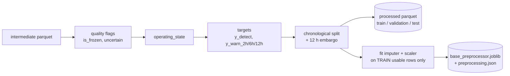

# 03 — Preprocessing, Target Construction & Data Splits (Stage 4b)

**Reproduce:** `.venv/bin/python scripts/build_processed.py` (~6 s) then `.venv/bin/pytest -q`.
**Code:** `src/predictops/preprocessing/` — `labels.py` (flags + targets), `splits.py`
(chronological splits + CV folds), `pipeline.py` (cleaning + scaler/imputer).
**Tables:** `reports/preprocessing_stats/`.

---

## 1. Pipeline overview

## 2. Data-quality flags (why rows are excluded, never deleted)
| Flag | Rule | Rows | Why |
|---|---|---|---|
| `is_frozen` | All 7 analog sensors identical for ≥ 360 readings (~1 h) | 50,418 (3.3%) | Stale logger values, not machine behaviour (docs/02 §7) |
| `uncertain` | Sustained failure signature **outside** reported windows | 17,459 | Possibly unreported failures; true status unknown (docs/02 §6) |
| `usable` | not frozen and not uncertain | — | Only usable rows are used to train and to score |

Rows are kept in the file with their flags, so nothing is silently discarded, and the dashboard
can still display them.

**Missing values / interpolation:** the raw data has none. For uploaded or inference data,
`clean_sensor_frame` (1) sorts and removes duplicate timestamps, (2) converts ±inf to NaN,
(3) forward-fills a missing reading **only if the gap is ≤ 60 s and inside one segment**,
and (4) leaves longer gaps as NaN for the training-fitted imputer. Large gaps (the 230
logger-off periods) are **never** interpolated; they start a new segment instead.

**Outliers:** kept. Extreme values are often the failure itself (docs/02 §4.1).

## 3. Target construction
The dataset has **no label column**. Targets are built only from the 4 official failure windows.

| Target | Definition | Question it answers |
|---|---|---|
| `y_detect` | 1 if the row is inside a reported failure window | "Is a failure **happening now**?" (detection) |
| `y_warn_2h` | 1 if a reported failure **starts** within the next 2 h | "Will a failure start soon?" (short-term early warning) |
| `y_warn_6h` | … within 6 h | medium-term |
| `y_warn_12h` | … within 12 h | longer-term |

Rules and assumptions:
- **Prediction horizons are in hours.** EDA found no change days ahead (docs/02 §9). 12 h is the
  upper limit because event 4's visible build-up is about 12 h.
- Rows **inside** a window have `y_warn = NaN` (undefined): the failure has already started, so
  "will it start?" makes no sense. They are excluded from warning models.
- Rows **after** a window are normal (0) for warning targets. Their maintenance dates in the PDF
  are inconsistent (docs/01 §9), so no recovery period is invented.
- Overlapping windows: none of the 4 windows or their 12 h pre-windows overlap.
- `minutes_to_onset` is stored **only for lead-time analysis**. It is computed from the future and is on the
  `FORBIDDEN_AS_FEATURES` list, which is enforced in tests.
- The failure boundaries are taken from the PDF exactly as given (approximate; see docs/02 §5).

### Usable positive rows per event
| Event | y_warn_2h | y_warn_6h | y_warn_12h | Note |
|---|---|---|---|---|
| 1 | **0** | **0** | **0** | The 12 h before onset are entirely **frozen data**, so there's no usable pre-failure signal |
| 2 | 727 | 2,179 | 4,358 | |
| 3 | 726 | 2,179 | 4,358 | |
| 4 | 726 | 2,179 | 4,357 | Test event |

**Consequence (an important limitation):** supervised early warning has only **2 usable onsets
(events 2 and 3) to learn from**, and 1 to test on. Any early-warning result will be presented
as a small case study, not a general claim.

## 4. Chronological splits
Random splitting is **not allowed**: rows 10 s apart are almost identical, so a random split leaks
near-copies of the same minute into the test set and makes results look far better than they are.

| Split | Period | Rows | Usable | Events | `y_detect` positives (rate) | `y_warn_12h` positives |
|---|---|---|---|---|---|---|
| train | 1 Feb → 20 May 12:00 | 779,894 | 755,440 | 1 | 8,566 (1.13%) | 0 |
| embargo | 12 h before each boundary | 7,462 | — | – | – | – |
| validation | 21 May → 30 Jun 12:00 | 285,990 | 249,779 | 2, 3 | 19,675 (7.88%) | 8,716 |
| test | 1 Jul → 1 Sep | 443,602 | 439,225 | **4** | 1,622 (0.37%) | 4,357 |

- **Embargo (12 h = longest horizon):** removes the last 12 h before each boundary. Without it, a
  training row's `y_warn_12h` label could depend on an event in the next split.
- **The test set (event 4) is held out.** It is evaluated **once**, at the end of model development,
  so we never tune against it.
- The positive rate differs a lot between splits (1.1% / 7.9% / 0.4%) because events differ in
  length. Thresholds therefore won't be chosen assuming a fixed base rate.

### Cross-validation for model selection: forward-chaining
`event_folds()` yields expanding-window folds inside the development period:

| Fold | Train | Validate on |
|---|---|---|
| A | 1 Feb → 26 May (before the event 2 block, minus embargo) | event 2 ± 3 days |
| B | 1 Feb → 2 Jun (includes event 2) | event 3 ± 3 days |

Leave-one-event-out CV was **rejected** because it would train on June data to evaluate May, which
uses the future to predict the past. Event 1 can't be a validation fold because there's no
earlier failure to learn from. A test (`test_forward_chaining_folds_never_train_on_future`)
checks this.

## 5. Scaling and imputation (fit on training data only)
`make_preprocessor()` = median imputer + **StandardScaler** for analog sensors, most-frequent
imputer for binary signals. It is fitted on **train ∩ usable** rows only (755,440 rows), saved to
`models/preprocessing/base_preprocessor.joblib`, and its parameters are recorded in
`models/metadata/preprocessing.json`. Validation, test and app inference call `.transform()` only.

**Scaler comparison (evidence-based choice):**
| Scaler | TP2 scale | DV_pressure scale | Verdict |
|---|---|---|---|
| RobustScaler (median/IQR), tried first | 0.004 bar | 0.004 bar | **Rejected**: TP2/DV_pressure are ~0 for over 50% of the time, so the IQR is tiny and a normal 10-bar reading becomes ≈ 2,500 |
| StandardScaler (mean/std) | 2.93 bar | 0.27 bar | **Chosen**: well-behaved scale for all sensors |

Tree models (Decision Tree, RF, XGBoost) don't need scaling. It matters for Logistic
Regression, SVM, LOF/One-Class SVM and neural networks.

**Redundant inputs dropped from the base feature set:** `Reservoirs` (r = 1.000 with TP3) and
`MPG` (r = 0.985 with COMP). They stay in the data, and final feature selection happens in Stage 4c.

This base preprocessor covers the raw sensors. Stage 4c will add engineered features and fit the
final preprocessor the same way (on training rows only).

## 6. Sample data (`data/sample/`)
Exact excerpts copied from the raw CSV text, in the original raw format, so they pass upload validation:
| File | Content | Use |
|---|---|---|
| `event4_2020-07-15.csv` | full day with event 4 (test period) | demo of failure detection and replay |
| `normal_day_2020-08-10.csv` | a normal day (test period) | demo of normal behaviour |
| `small_2h_2020-08-10.csv` | 2 hours | quick upload and API tests |

All samples come from the **test period**, so a demo never shows a model its own training data.

## 7. Leakage-prevention checklist (all enforced by `tests/test_preprocessing.py`)
| Risk | Prevention | Test |
|---|---|---|
| Future info in features | `FORBIDDEN_AS_FEATURES` list | `test_future_columns_are_forbidden_as_features` |
| Warning label marks rows after onset | label only `[start−H, start)` | `test_warning_target_only_before_onset` |
| Splits overlap or are out of order | time boundaries + embargo | `test_splits_are_chronological_and_disjoint` |
| Test event leaks into development | event 4 only in test | `test_test_split_holds_only_event_4` |
| CV trains on the future | forward-chaining folds | `test_forward_chaining_folds_never_train_on_future` |
| Scaler sees validation/test data | fit on train usable rows | `test_saved_preprocessor_matches_train_statistics`, `test_preprocessor_learns_from_fit_data_only` |
| Interpolating across long gaps | ffill ≤ 60 s within segment | `test_clean_fills_only_short_gaps_and_handles_inf` |

## 8. Limitations
- Only 2 usable training onsets for early warning (event 1's pre-failure data is frozen).
- The validation period contains the two most similar events (2, 3). The test event (4) has a different
  pattern, which is a realistic but hard test.
- `uncertain` is defined with a descriptive signature derived from the reported windows. It's a
  conservative exclusion, not a label.
