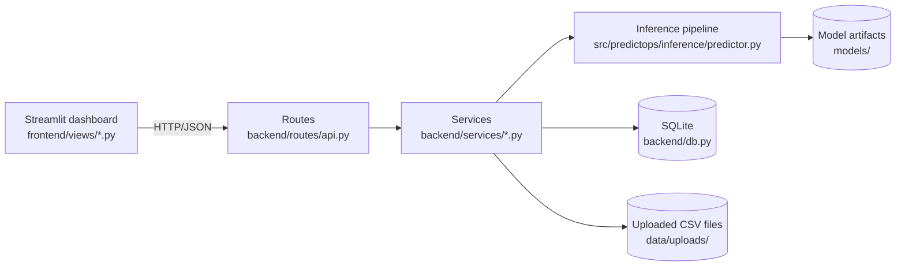
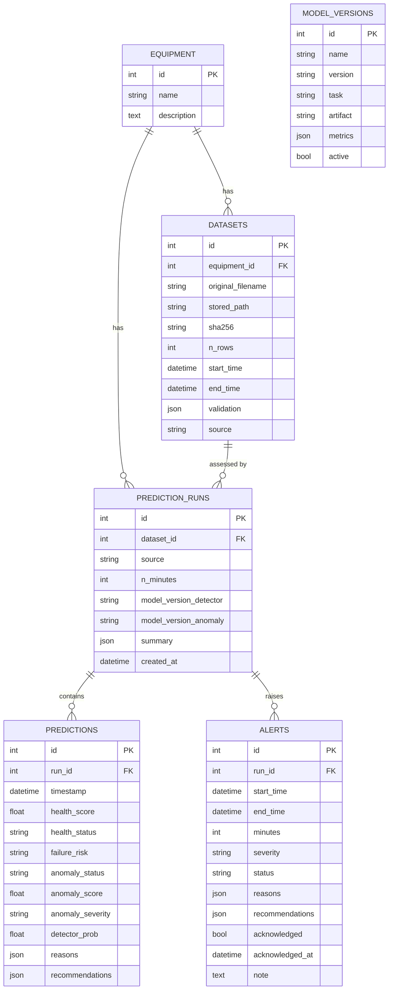

# 08 — Application: Backend, Database, Dashboard, Replay, Reports, Monitoring, Security (Stages 7, 15–19, 22)

**Run locally:** `.venv/bin/python run.py` → API http://127.0.0.1:8000/docs · Dashboard http://localhost:8501
(or separately: `.venv/bin/uvicorn backend.main:app --port 8000` and `.venv/bin/streamlit run frontend/app.py`).
**Real request/response examples:** `docs/api_examples/*.json`, captured from the running API.

---

## 1. Layered design



| Layer | Responsibility | Files |
|---|---|---|
| Routes | HTTP, input validation (Pydantic), status codes | `backend/routes/api.py`, `backend/schemas.py` |
| Services | business logic: upload handling, running and storing predictions, model info | `backend/services/` |
| Data access | SQLAlchemy models, sessions | `backend/db.py` |
| Inference | **the same code path as training** (clean → features → models → health engine) | `src/predictops/inference/predictor.py` |
| Config and auth | environment settings, optional API key | `backend/settings.py`, `backend/dependencies.py` |

Models are loaded **once** at startup (`lifespan` plus a cached `get_predictor()`), and no request ever retrains a model.

## 2. API endpoints
| Method | Path | Purpose |
|---|---|---|
| GET | `/health` | application health check (models loaded, DB reachable, model versions) |
| GET | `/models`, `/models/performance`, `/models/versions`, `/models/curves` | model info, all evaluation tables, registered versions, test ROC/PR curves |
| POST | `/datasets/upload` | CSV upload: extension and size checks, validation, safe storage |
| GET | `/datasets`, `/datasets/samples`, `/datasets/{id}/sensors` | dataset list, bundled samples, sensor series (resampled) |
| POST | `/predict` | **batch** assessment of an uploaded dataset or a sample, stored as a run |
| POST | `/predict/observations` | **individual / streaming-style** assessment from JSON raw readings (range-checked) |
| GET | `/runs`, `/predictions`, `/predictions/download` | prediction history (filter by run or time) and CSV download |
| DELETE | `/runs/{id}` | delete a run (cascades to its predictions and alerts) |
| POST | `/explain` · GET `/explain/global` | SHAP and anomaly deviations for one minute · global importance |
| GET | `/alerts` · POST `/alerts/{id}/acknowledge` | maintenance alerts and acknowledgement with a note |
| GET | `/dashboard/stats`, `/history`, `/history/events` | dashboard KPIs, precomputed historical assessment, alert episodes |
| GET | `/replay/step` | **historical replay**: runs the full pipeline on raw readings up to time *t* |
| GET | `/monitoring/drift`, `/monitoring/monthly` | feature drift (KS, PSI) and prediction drift |
| GET | `/reports/run/{id}.pdf` | PDF maintenance report |

### Example: batch prediction on a bundled sample
```http
POST /predict
{"sample_name": "event4_2020-07-15.csv"}
```
Response (abridged from `docs/api_examples/predict_event4.json`):
```json
{"run": {"id": 3, "source": "sample", "n_minutes": 1433, "start_time": "2020-07-15T00:01:00",
         "model_version_detector": "xgboost-v1-20261106", "model_version_anomaly": "anomaly-ocsvm-v1-20261106",
         "summary": {"status_counts": {"Healthy": 1204, "Critical": 188, "Warning": 41}, "anomalous_minutes": 211, "min_health_score": 27.5}},
 "latest": {"timestamp": "2020-07-16T00:00:00", "health_status": "Healthy", "...": "..."},
 "alerts": [{"start_time": "2020-07-15T16:35:00", "end_time": "2020-07-15T19:32:00", "minutes": 177, "severity": "high",
             "status": "Critical", "reasons": ["Persistent anomaly: ...", "panel pressure TP3 (30-min mean) is below its normal range ..."],
             "recommendations": ["Persistent abnormal behaviour: schedule an equipment inspection.", "..."]}]}
```

### Example: explanation of one minute (`docs/api_examples/explain.json`)
```http
POST /explain
{"run_id": 3, "timestamp": "2020-07-15T18:31:00", "top_k": 4}
```
Returns `detector_probability` 0.100 (threshold 0.516), `anomaly_score` above threshold, `health_status` "Critical",
SHAP contributions (TP3_mean_5min +2.53, DV_pressure terms negative) and the anomaly model's most deviating features.

### Example: errors are structured JSON
| Request | Status | Body |
|---|---|---|
| upload `README.md` | 415 | `{"detail": "Only .csv files are accepted."}` |
| upload a file over `MAX_UPLOAD_MB` | 413 | size message |
| upload an empty CSV | 422 | "The file is empty." |
| CSV without `TP3` | 201 + `validation.ok=false`; then `/predict` → 422 | lists the missing columns |
| observation with TP3 = 999 | 422 | Pydantic range error |
| unknown run / alert / sample | 404 | message |
| replay time inside a logger gap | 422 | "No recorded data near this time" |
| missing model artifacts | 503 | "Missing model artifact … Run the training scripts." |
| any unexpected error | 500 | generic message only (details go to `logs/api.log`, never to the client) |

## 3. Database (SQLite via SQLAlchemy; PostgreSQL = change `DATABASE_URL`)



- **No large duplicate sensor data in the DB:** uploaded CSVs stay on disk (`data/uploads/<uuid>.csv`), and `datasets.stored_path` references them.
  The DB holds what the application *produces* (one row per assessed minute, alerts, acknowledgements).
- **Traceability:** every run stores the exact model versions that produced it.
- **Indexes:** `(equipment_id, timestamp)` and `run_id` on predictions; `start_time` and `acknowledged` on alerts; `sha256` on datasets.
- **Integrity:** foreign keys are enforced in SQLite (`PRAGMA foreign_keys=ON`); deleting a run cascades to its predictions and alerts.
- **Authentication:** not stored in the DB. A single API key (environment variable) protects public deployments. No user accounts were needed.

## 4. Dashboard (Streamlit + Plotly), 10 pages
Dark navy theme, blue/cyan accents, status colours green/amber/red **always shown with an icon and a text label**.
The chart palette was checked with a colour-validation script for colour-blind safety and contrast on the navy background (all checks pass).
Screenshots: `reports/screenshots/*.png`.

| Page | Shows (all from the API) |
|---|---|
| Overview | observations, current health/risk/anomaly status, alert count, 7-month health trend (in-sample vs unseen marked), status share, recent alerts, latest predictions |
| Sensor Monitoring | selectable sensors as **separate panels (never two y-axes)**, time-range filter and failure presets, rolling mean overlay, failure windows and alert shading, statistics, table view |
| Historical Replay | steps through recorded data; **each step re-runs the full pipeline on raw readings**; live-updating cards, charts, reasons and actions; clearly labelled "historical replay" |
| Failure Prediction | sample / uploaded / new CSV upload with validation; batch run; signature score vs threshold; risk markers; SHAP for any minute; run history; CSV and **PDF** downloads; prediction-horizon disclaimer |
| Anomaly Detection | score timeline with low/medium/high thresholds, alert shading, severity distribution, alert episode table, abnormal measurements at the worst minute |
| Explainable AI | SHAP concepts explained, global importance, per-minute SHAP **waterfall**, anomaly deviations, engine reasons |
| Equipment Health | current, lowest and Critical-share cards; trend with Healthy/Warning/Critical bands; risk indicator mix; "why this classification" for any minute |
| Maintenance | open/acknowledged alerts with issues and actions, acknowledgement with notes (history), dataset-wide alert history |
| Model Performance | validation vs test comparison, confusion matrices, ROC/PR curves, anomaly and DL tables, health engine, warning and imbalance results |
| Data & Model Monitoring | monthly prediction and feature drift, drift check for any window or upload, datasets and validation status, model versions |

Charts break their lines at recording gaps (`lib/api.py::break_gaps`), so no chart draws data that doesn't exist.

## 5. Historical replay (Stage 15)
- `/replay/step?t=…` takes the **recorded raw 10-second readings** in `(t − 25 h, t]` (25 h covers the 24 h baseline features), runs
  `PredictOpsPredictor.predict_raw`, the exact function used for uploads, and returns the latest minute's assessment. Training, upload
  and replay therefore share one preprocessing and feature path.
- Verified: replaying 15 Jul 18:30 gives health 27.5, Critical, risk High, the same as the batch run over the sample day.
- It is labelled everywhere as **historical replay / simulated monitoring**; no simulated sensor values are generated.

## 6. Reports (Stage 19)
- **CSV:** `/predictions/download?run_id=…` gives every assessed minute with reasons, recommendations and model versions.
- **PDF:** `/reports/run/{id}.pdf` (reportlab) contains equipment and period, model versions, health assessment, time per status,
  sensor summary, alert table (with acknowledgement status), the worst minute's reasons, SHAP contributions and anomaly deviations,
  deduplicated maintenance recommendations, a generation timestamp, and the limitations. Every value comes from stored results.

## 7. Monitoring (Stage 18): results
`scripts/monitoring_report.py` → `reports/monitoring/monthly_drift.csv`, `reports/figures/monitoring/monthly_psi_heatmap.png`.

| Month | Split | Features with major drift (of 18) | Top drifting feature | Unusual-minute share |
|---|---|---|---|---|
| Feb | train | 14 | Oil_temperature_std_30min | 0.00% |
| Mar | train | 9 | Oil_temperature_std_30min | 0.10% |
| Apr | train | 5 | Oil_temperature_std_30min | 4.77% (event 1, unreported 12 Apr) |
| May | train | 8 | Oil_temperature_std_30min | 1.58% (unreported 13 May, 19–20 May) |
| Jun | validation | 12 | Oil_temperature_mean_30min | 9.44% (event 3) |
| Jul | test | 11 | Oil_temperature_mean_30min | 1.43% (event 4) |
| Aug | test | 13 | Oil_temperature_mean_30min | 0.13% |

**Interpretation:**
- Even training months show "major" PSI against the pooled February–May reference. Month-to-month operating conditions differ, and
  the textbook 0.1/0.25 PSI cut-offs are too sensitive for these multi-modal signals. Drift must be judged **relative to the variation
  seen during training**, not with fixed textbook thresholds.
- The summer months' top drift is **oil temperature level**, the seasonal effect seen in EDA. The health engine already compensates
  with 24 h-baseline features.
- **Prediction drift** (share of unusual minutes) jumps exactly in the months with failures and unreported episodes. In August, with
  no reported failure, it's 0.13%, close to the 0.5% design rate.
- **Data drift vs concept drift vs performance degradation:** drift says the inputs changed; concept drift would mean the input→failure
  relationship changed; degradation can only be *measured* with new failure labels. Without new labels PredictOps can only warn
  that inputs look different, and it says so in the UI and API.

## 8. Security (Stage 22)
| Measure | Implementation |
|---|---|
| File type validation | `.csv` only (415 otherwise); content must parse as CSV and pass schema validation |
| Upload size limit | streamed in 1 MB chunks, rejected above `MAX_UPLOAD_MB` (413); Streamlit `maxUploadSize = 50` |
| Safe file handling | client filename never used as a path (`Path(name).name`); stored as a server-generated UUID; path traversal test passes |
| Input validation | Pydantic schemas with physical range checks; JSON observations limited to 20,000 readings; time windows limited |
| Authentication | `API_KEY` env var → every request needs `X-API-Key` (enabled automatically in `render.yaml`) |
| CORS | explicit origin list from `CORS_ORIGINS`, not `*` |
| Error handling | structured 4xx messages; 500s return a generic message, stack traces only in `logs/api.log` |
| Configuration | `.env` (git-ignored) + `.env.example`; no secrets in code |
| Artifact exposure | only model *metadata* is served; joblib files are never downloadable |
| Container | runs as a non-root user; only runtime files copied (`.dockerignore` excludes raw data, DB, logs, tests) |
| Logging | every request logged with method, path, status and latency |
| Pickle risk | models are loaded only from the project's own `models/` folder; uploads are parsed as CSV, never unpickled |
