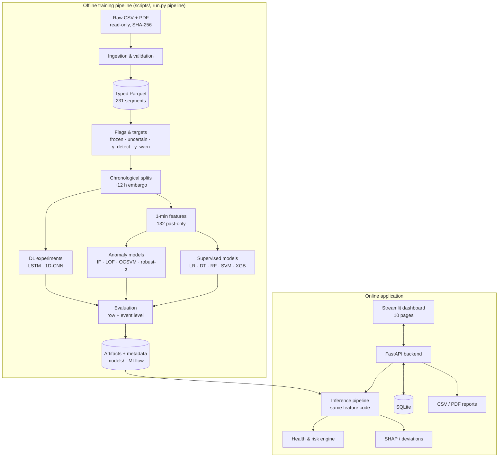
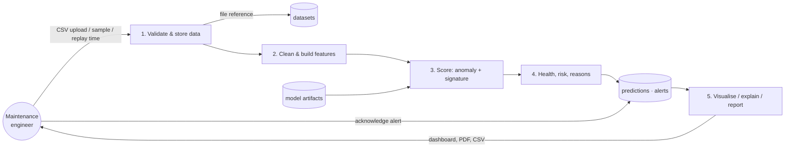
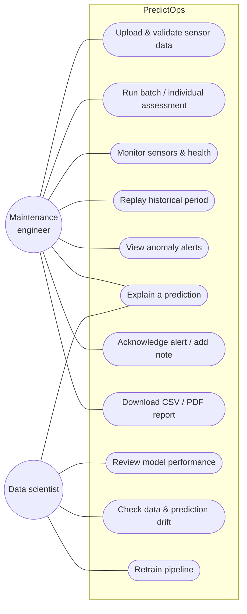
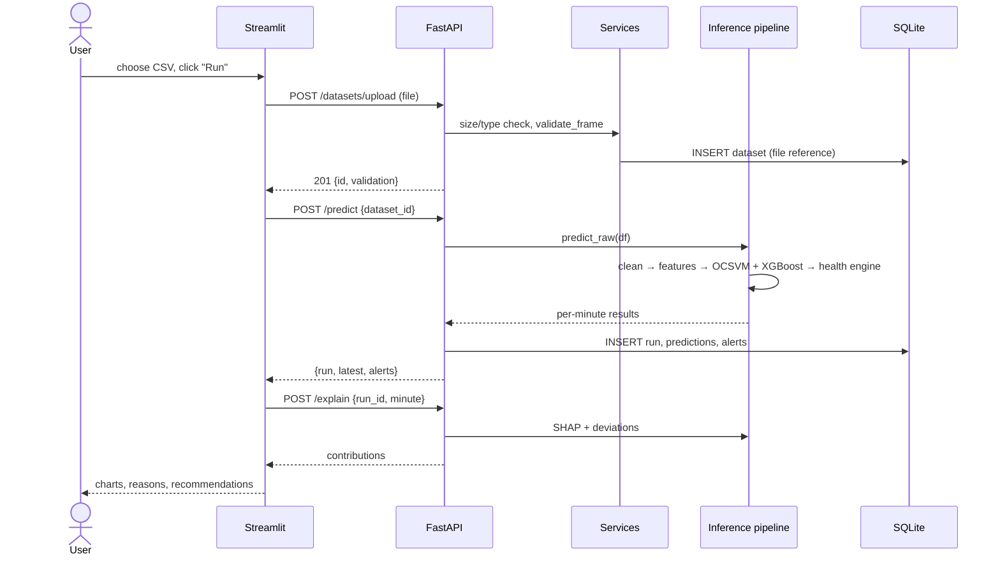
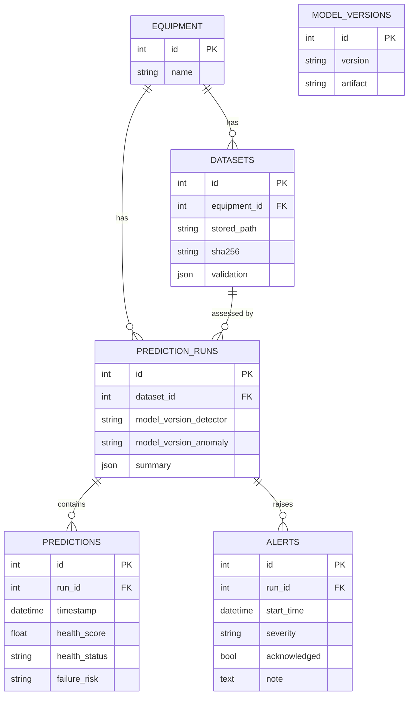
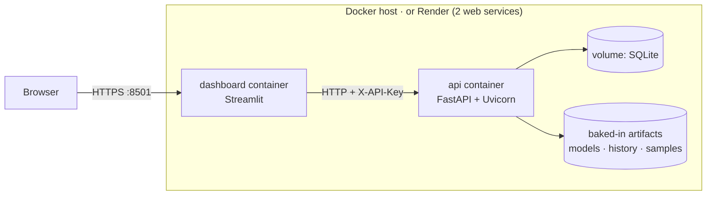

# 11 — Technical Diagrams (Mermaid)

These render on GitHub, in VS Code (Markdown Preview Mermaid Support) and at https://mermaid.live (paste a block to export PNG/SVG for slides).

## 1. System architecture

**Explanation:** the offline part turns raw data into versioned artifacts; the online part loads them once and serves assessments.
Both use the same `src/predictops` code, so training and inference preprocessing can't diverge.

## 2. Data flow diagram (Level 1)


## 3. ML pipeline
```mermaid
flowchart LR
    A[10 s readings] --> B[sort · dedupe · validate]
    B --> C[segment at gaps > 10 min]
    C --> D[flag frozen / uncertain]
    D --> E[1-min aggregation<br/>(t−1, t]]
    E --> F[rolling 5 m / 30 m / 2 h<br/>lags · baselines · duty cycle]
    F --> G{training only}
    G --> H[variance + correlation filter<br/>XGB-gain top 33]
    G --> I[imputer + scaler fit]
    H & I --> J[models]
    J --> K[threshold on OOF validation]
    K --> L[select BEFORE test]
    L --> M[single test on event 4]
```

## 4. Use-case diagram


## 5. Sequence diagram — batch prediction


## 6. Database ER diagram

**Explanation:** runs record which model versions produced them (traceability); sensor files are referenced, not duplicated.

## 7. Deployment architecture

**Explanation:** one image, two services (different start commands). Locally: `docker compose up`. Render: `render.yaml`
blueprint, with an auto-generated API key and a health check on `/health`.
